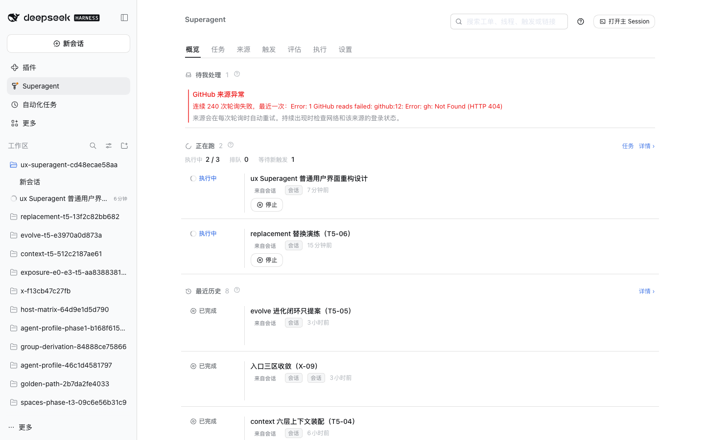
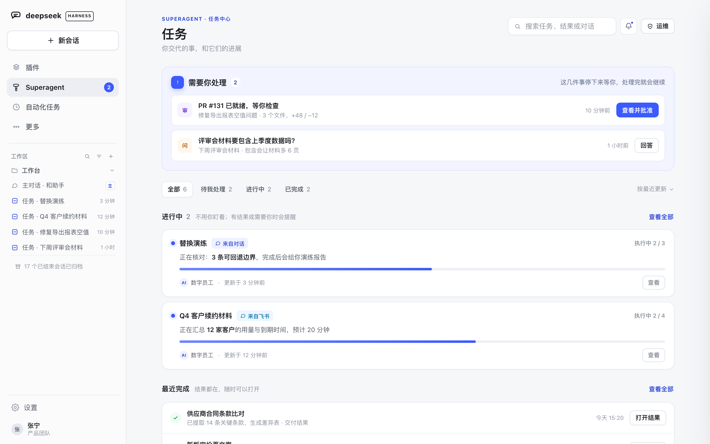
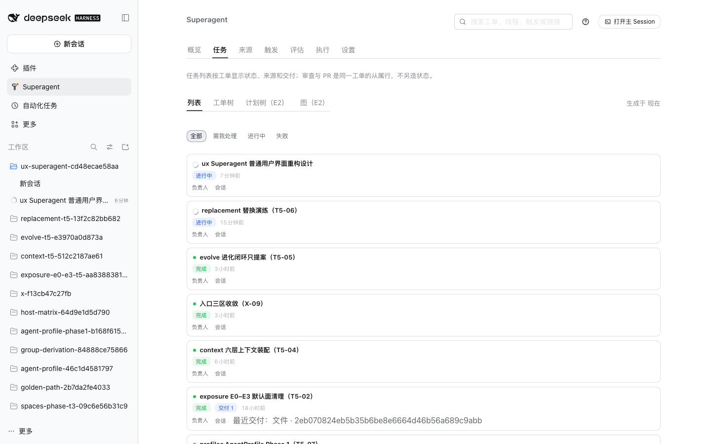
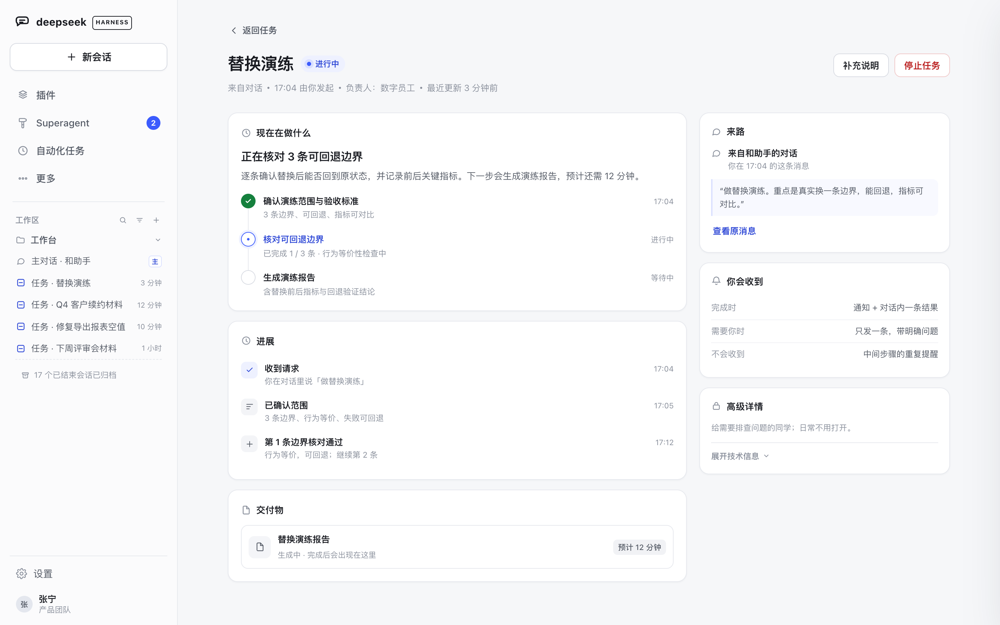
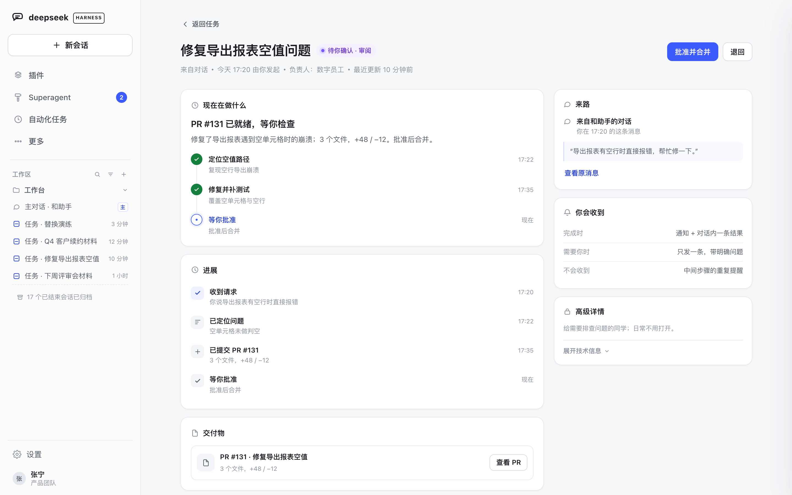
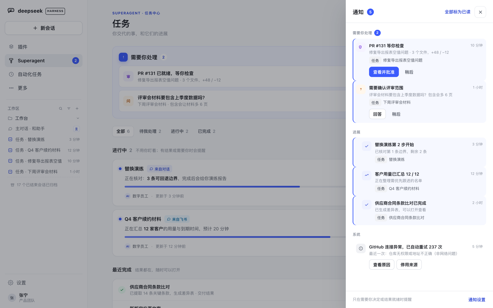
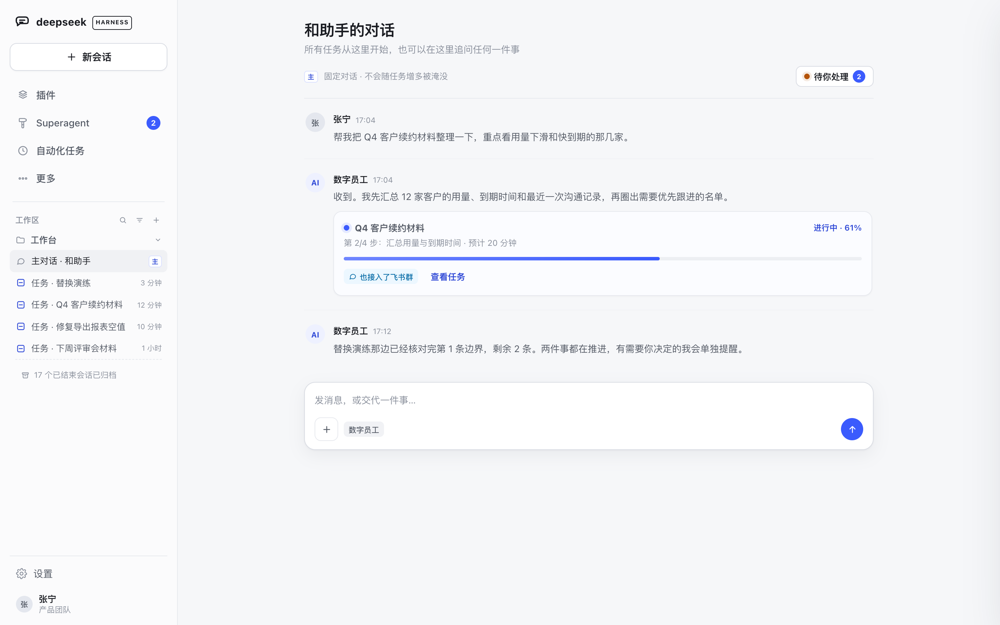
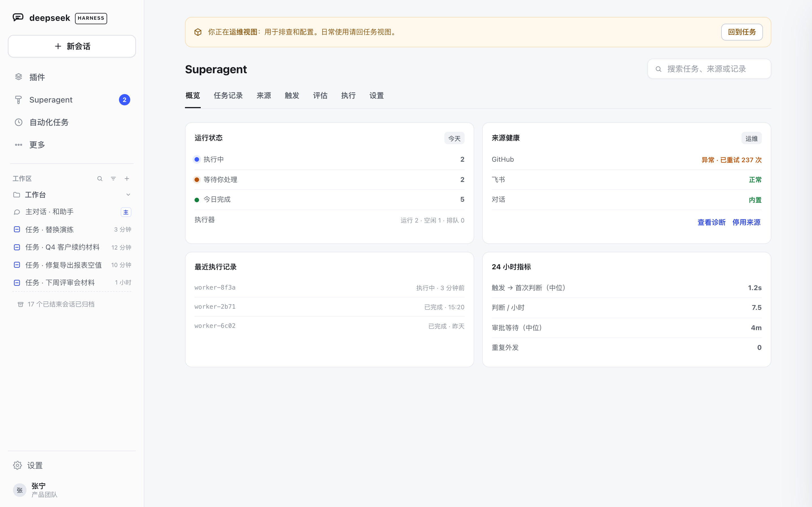
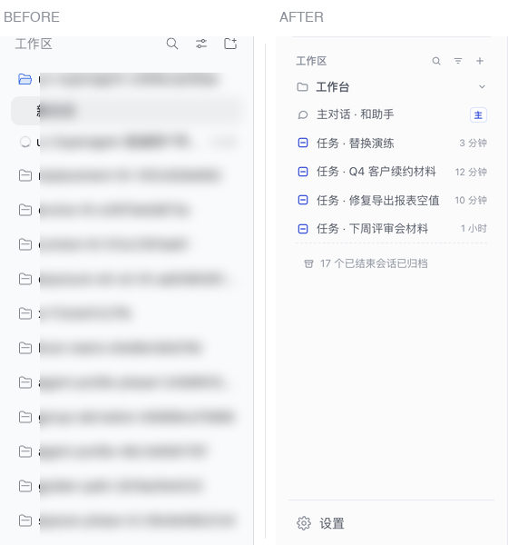
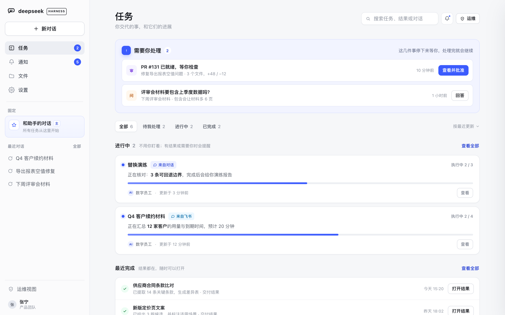

# Superagent 普通用户界面重构设计（提案）

> **状态**：设计提案，未实现。本文回答「普通用户看到的界面应该长什么样、为什么、落在哪个 DSH 插件扩展点、怎么分阶段验证」，不含业务代码改动。
>
> **约束**：一切皆 DSH 插件。方案以「独立插件装进 DSH（含桌面端）」为前提：UI 只用插件扩展点（面板、右栏、状态页插槽、会话入口、manifest 驱动设置），后端跑在插件进程内；**不改 DSH 核心、不 fork**。超出插件边界的部分单列在 §8「宿主增强取舍」。
>
> **证据**：改造前截图来自当前运行实例（1440×900，浅色，`2026-11-11`）；改造后为可交互原型（同尺寸、同主题、合成数据），见 [`prototype.html`](prototype.html) 与 [`images/`](images/)。原型不是已实现界面。
>
> **基线**：`touch-agent/dsh-superagent` @ `73709a4`，宿主 DSH `0.2.1-rc.5`。工单 `cd48ecae…`。
>
> **迁移**：本设计与截图、原型已迁至 `touch-agent/dsh-superagent` 的 [`docs/021-ux-redesign.zh.md`](https://github.com/touch-agent/dsh-superagent/blob/main/docs/021-ux-redesign.zh.md)（迁移 PR [#58](https://github.com/touch-agent/dsh-superagent/pull/58)）。此页保留为历史原文，不再更新。

---

## 0. 结论

1. **现在这页是「运维控制台」，不是「用户首页」。** 顶部七个 tab（概览 / 任务 / 来源 / 触发 / 评估 / 执行 / 设置）里，五个是运维/内部流程；首屏最醒目的是 GitHub 连续失败 237 次的红色告警，而不是「需要你做什么」。
2. **左栏是文件系统模型，不是工作模型。** 插件入口、工作区（目录名）、会话（含每个任务的执行会话）三套体系混排；并发任务越多，会话越多，主会话被淹没，任务执行会话与普通会话同形同列、难以区分。
3. **任务视角存在，但读起来还是「工单列表」。** 计划编号、`负责人：会话`、没有来源、没有「下一步」、没有「为什么停在这里」；普通用户无法把它当成自己的任务。
4. **通知不是一个「地方」。** 它藏在右栏「事件」tab 里，全局没有醒目的未读入口；错误以横幅形式长期占据首屏，而且只告诉用户「检查网络」。
5. **根因不是信息太少，而是实现模型直接漏到了界面上。** 目录、Session、Trigger、Eval、Assignment、Worker 都是实现概念；用户需要的是「对话 / 任务 / 结果 / 通知 / 来源」五个对象。

**方案一句话**：**一个主对话 + 一个任务收件箱 + 一层通知，运维视图后置。**

> 这里的「首页」指 **Superagent 面板的默认页**，不是 DSH 的全局首页——全局首页由宿主决定，插件不越界。

- **主对话**：唯一固定入口，所有任务从这里开始；永远置顶、永远叫「主对话」，不随任务增多被淹没。
- **任务收件箱**：默认首页。第一屏只回答三件事——**需要你处理 / 正在进行 / 最近完成**。
- **通知层**：只在需要人决定、结果就绪、系统持续失败时出现；按任务聚合，带就地动作。
- **运维视图**：来源 / 触发 / 评估 / 执行 / 设置整体收进显式入口，默认面看不到内部词。

**可落地性**：上述默认面、任务详情、通知聚合、术语分层、左栏治理，**都能在现有插件扩展点内完成**；只有「左栏彻底任务化、全局通知中心、隐藏执行会话」需要宿主改动，单列 §8，不混进本期承诺。

| 改造前 | 改造后（设计原型） |
| --- | --- |
|  |  |
|  |  |

> 上表不是同一数据状态的像素级对照：**Before** 是当前真实运行实例，**After** 是设计原型。相同的是 1440×900 视口、浅色主题，以及「用户来找任务」这一场景；像素级对照在实现 PR 中补。左栏的前后对照见 §4.6；Before 截图中的会话名已脱敏。

---

## 1. 现在的页面为什么难用

### 1.1 三个真实画面

- **主界面**（`images/before-01-home.png`，会话名已脱敏）：左栏「工作区」下是一长串会话，`replacement-t5-…`、`evolve-t5-…`、`context-t5-…`……用户不知道哪些是自己的对话、哪些是任务执行会话；主会话没有稳定位置。
- **Superagent 概览**（`images/before-02-overview.png`）：首屏最大面积是「GitHub 来源异常 · 连续 237 次轮询失败」；「待我处理」只有 1 条，被压在告警下面；「正在跑 / 最近历史」以工单为单位，信息密度高但没有「下一步」。
- **任务 tab**（`images/before-03-tasks.png`）：列表行只有标题、状态、时间、`负责人：会话`；没有来源、没有交付物、没有「我需要做什么」；还混着 `T5-06`、`E0–E3` 这类计划编号。

### 1.2 七个具体问题

| # | 问题 | 表现 | 用户感受 |
| --- | --- | --- | --- |
| 1 | 默认面是运维台 | 7 个 tab，5 个是运维/内部流程；首屏最大位置给系统告警 | 「我不是运维，为什么要懂这些？」 |
| 2 | 左栏三套体系混排 | 插件入口 / 工作区（目录名）/ 会话（含每个任务的执行会话）在同一列 | 「哪个是主对话？这些目录和会话哪来的？」 |
| 3 | 并发任务 = 会话膨胀 | 每个 tracked 任务一个 worker Session；结束后仍留在列表；没有归档策略 | 「任务越多越找不到东西」 |
| 4 | 任务视角是工单视角 | 计划编号、`负责人：会话`、无来源、无下一步 | 「这是给研发看的，不是给我的」 |
| 5 | 通知不成体系 | 只在右栏「事件」tab；全局无未读入口；错误横幅不聚合、不可操作 | 「有动静我不知道；知道了也不知道该干嘛」 |
| 6 | 概念没有分级 | Trigger / Eval / Execution / Assignment / Worker 直接出现在默认面 | 「要先学一套概念才能用」 |
| 7 | 失败不可行动 | 「检查网络和该来源的登录状态」；没有「停用 / 重新登录 / 复制诊断」 | 「红字看懂了，然后呢？」 |

### 1.3 用户实际只问五个问题

1. **现在有什么事需要我？**（数量 + 一条明确问题 + 一个动作）
2. **我的任务到哪了？**（在做什么、下一步、大概什么时候）
3. **刚刚发生了什么？**（结果在哪、有没有需要我看的）
4. **主对话在哪？**（永远一键可达，不被新会话淹没）
5. **这件事从哪来的？**（对话 / 飞书 / GitHub / 系统，而不是「目录」）

> **10 秒测试**：一个没用过的人打开首屏，10 秒内能否说出「我现在要做什么、我的任务到哪了、主对话在哪」。当前页面做不到；本设计把它作为验收标准。

### 1.4 根因

当前 UI 基本是**领域模型的直译**：Source → Trigger → Thread → Eval → Ticket → Assignment → Session → Deliverable。这个模型对审计是对的，对首次使用是错的。缺的是一层**用户对象**：

```
实现对象（保留，审计用）    用户对象（新增，默认面）
Source / Channel        →   来源（来自对话 / 飞书 / GitHub）
Ticket / Assignment     →   任务（目标、状态、下一步、结果）
Worker Session          →   执行过程（默认隐藏，任务详情里的「高级详情」）
Trigger / Eval / Thread →   消息与判断（运维视图 / 审计）
Deliverable             →   结果（可打开、可批准）
Activity / Notice       →   通知（按任务聚合）
```

---

## 2. 设计目标与原则

### 2.1 目标

- **10 秒**回答 §1.3 的五个问题。
- **并发 10 个任务**仍然清楚：任务按「待我处理 / 进行中 / 已完成」组织，不按目录或会话组织。
- **零学习成本**：默认面不出现 Trigger、Eval、Execution、Assignment、Worker、Session 这些词；需要时在「运维」里能看到原名。
- **通知不淹没**：一条结果一条通知；只有需要人决定、结果就绪、系统持续失败才打扰。
- **可安装、可升级、可回退**：不要求改 DSH 核心；每个新面有 feature switch。

### 2.2 原则

1. **任务是一等公民，会话是实现细节。** 用户管理任务，不管理会话；执行会话只在任务详情里出现。
2. **一主一辅。** 主对话是日常入口；任务收件箱是审查面。两者不是两套系统，是同一批数据的两种视图。
3. **先回答「要不要我」，再展示「在做什么」。** 需要人处理的事永远在最上面，且带就地动作。
4. **来源是锚点，不是层级。** 一个任务可能来自对话、飞书、GitHub；来源显示为 chip，不把任务拆成多份。
5. **术语分级。** E0 结果层用人话；E1 审查层给目标/状态/交付/验收；E2/E3 才出现 Trigger、Eval、Assignment、Session。
6. **安静默认。** 健康状态不占空间；中间步骤不重复提醒；错误聚合且可行动。
7. **插件边界内解决。** 不假装能改宿主左栏；能做的做透，做不到的单列取舍。

### 2.3 非目标（本期）

- 不做完整项目管理系统（看板、甘特、依赖图）——首版只做列表 + 详情。
- 不改授权模型、Mandate、Approval 语义；只改呈现与入口。
- 不做移动端原生；窄屏按插件面板自适应。
- 不替用户自动决定「哪些任务需要人」；只把已有 stage 投影成人话。

---

## 3. 信息架构

### 3.1 结构

```
┌─────────────────────────────────────────────────────────────┐
│ 主对话（唯一固定入口）                                        │
│ 说一句话 / 发文件 / 追问 → 成为任务或留在对话                 │
└──────────────────────────┬──────────────────────────────────┘
                           │ 产生 / 关联
┌──────────────────────────▼──────────────────────────────────┐
│ 任务收件箱（默认首页）                                        │
│ ① 需要你处理（N）  → 就地批准 / 回答 / 补充                   │
│ ② 进行中（N）      → 在做什么、下一步、预计                    │
│ ③ 最近完成（N）    → 结果、交付物、打开                        │
└──────────────────────────┬──────────────────────────────────┘
                           │ 点开
┌──────────────────────────▼──────────────────────────────────┐
│ 任务详情                                                      │
│ 现在在做什么 / 下一步 / 进展 / 交付物 / 来路 / 高级详情         │
└──────────────────────────┬──────────────────────────────────┘
                           │ 推送
┌──────────────────────────▼──────────────────────────────────┐
│ 通知（按任务聚合） 需要你处理 · 进展 · 系统                     │
└─────────────────────────────────────────────────────────────┘

运维视图（显式入口，E2/E3）：来源 · 触发 · 评估 · 执行 · 设置 · 审计
```

### 3.2 用户对象

| 用户对象 | 一句话定义 | 从哪来 | 默认显示 |
| --- | --- | --- | --- |
| **对话** | 人和助手连续交流的地方 | 主 Session / 普通会话 | 主对话固定置顶 |
| **任务** | 一件有目标、状态、结果的事 | Ticket（根 Ticket，必要时含子 Ticket） | 收件箱、任务详情 |
| **结果** | 任务的交付物 / 结论 / PR | Deliverable、Report、PR | 任务行、详情 |
| **通知** | 只在需要人时出现的一条提醒 | Activity / Notice | 通知中心、徽标 |
| **来源** | 这件事从哪来 | Trigger / Thread / Channel | 任务 chip、详情「来路」 |
| **执行过程** | 具体怎么做的（会话、步骤、日志） | Assignment / Worker Session | 只在「高级详情」 |

### 3.3 页面职责

| 页面 | 只回答 | 不做 |
| --- | --- | --- |
| 任务收件箱 | 需要我做什么、在跑什么、刚完成什么 | 不展示 Trigger/Eval/日志 |
| 任务详情 | 做到哪、下一步、结果在哪、从哪来 | 不展示完整审计（折叠到高级详情） |
| 通知 | 哪件事需要我、点一下能做什么 | 不重复展示任务全貌 |
| 主对话 | 我现在想说什么、这件事进展如何 | 不要求用户管理会话 |
| 运维视图 | 为什么失败、怎么配置、审计链 | 不作为默认首页 |
| 设置 | 通知、来源、执行、显示偏好 | 不和日常任务混排 |

### 3.4 插件边界内的导航落点

宿主左栏由 DSH 拥有，插件不能重排或过滤。可用的落点如下（§6 有逐项映射）：

| 用户要去 | 落点 | 说明 |
| --- | --- | --- |
| 任务收件箱 | `main` 面板（Superagent 图标） | 插件自己的整页；默认路由从「概览」改为「任务」 |
| 通知 | 右栏「通知」tab + 面板头部铃铛 + 主对话头部 chip | 三个入口指向同一份通知数据 |
| 任务（速览） | 右栏「任务」tab | 与收件箱同一投影 |
| 主对话 | 新建会话的「主会话」入口 + 左栏「主」徽标 + 置顶 | 插件可注册入口、徽标；置顶用宿主 workspace pin |
| 会话内看任务 | 会话「状态」tab | 复用任务收件箱，不另做一套 |
| 运维 | 面板右上「运维」 | 七个旧 tab 收进这里 |
| 任务执行会话 | 左栏会话行（重命名 + 归档；图标视宿主行状态） | 不能隐藏；只能让它可识别、可收敛 |

### 3.5 Before / After 对照

| 维度 | 现在 | 设计后 |
| --- | --- | --- |
| 默认页 | 概览（告警 + 流水） | 任务收件箱（待我处理 → 进行中 → 最近完成） |
| 一级导航 | 7 个 tab，5 个运维/内部流程 | 任务；运维收进一个入口 |
| 任务行 | 标题 + 状态 + `负责人：会话` | 目标 + 状态 + 下一步 + 来源 + 结果 |
| 通知 | 右栏「事件」tab，无全局入口 | 面板徽标 + 头部 chip + 右栏 tab + 通知面板 |
| 左栏 | 工作区 / 会话混排，主会话淹没 | 主对话置顶 + 执行会话可识别 + 结束后归档 |
| 术语 | Trigger/Eval/Execution/Assignment 直接出现 | 人话默认，原名在运维/高级详情 |
| 错误 | 红色横幅，长期占首屏 | 聚合到系统通知，带「查看原因 / 停用来源」 |

---

## 4. 关键界面设计

### 4.1 任务收件箱（默认首页）


**结构**（从上到下）：

1. **需要你处理 N**：不能自动继续的事。每条包含「一句人话标题 + 是哪件事 + 多久前 + 一个主动作」。
   - 审阅 → 「查看并批准」
   - 提问 → 「回答」
   - 审批 → 「批准 / 拒绝」
   - 补充 → 「补充说明」
   区块为空时整块消失，不占空间。
2. **筛选**：全部 / 待我处理 / 进行中 / 已完成；默认「全部」，但排序永远是「需要你处理 → 进行中 → 最近完成」。
3. **进行中**：每张卡回答三件事——在做什么（**加粗的当前动作**）、进度（第几步/共几步 + 进度条）、更新于何时；底部是执行者（「数字员工」）和「查看」。
4. **最近完成**：标题 + 一句结果 + 交付链接 + 完成时间；「打开结果」直接到交付物。
5. **底部一句话**：解释「没有出现的任务，直接在主对话里问我；我只在需要你决定时提醒你」——降低「是不是漏了」的焦虑。

**设计要点**：

- 第一屏（900px 高）必须同时看到「需要你处理」和至少一个「进行中」；不需要滚动才知道有事。
- 任务标题不带 `T5-06`、`M5` 这类计划编号；如果原始标题带，展示时去掉（保留在高级详情）。
- 状态词统一：`排队中 / 进行中 / 待你确认 / 已完成 / 已取消 / 被卡住`。
- 不为空状态写长文案：一张卡 + 一个「在主对话里开始」按钮即可。

**空 / 错 / 载入**：

| 状态 | 显示 |
| --- | --- |
| 空 | 「现在没有任务。在主对话里交代一件事，或从飞书/GitHub 转进来。」+ 主对话按钮 |
| 载入 | 三条骨架行，不显示转圈遮罩 |
| 数据失败 | 一行「任务暂时读不到」+ 重试；不把整页替换成错误页 |
| 来源异常 | 不进任务区；进通知「系统」组，聚合为一条 |

**10 秒验收**：首屏能一眼回答「有 2 件要我处理（审 PR / 回答一个问题）」「2 件在跑，分别在做什么」「最近完成了什么」。

### 4.2 任务详情


**结构**：

- **头部**：人能读的标题 + 状态 pill + 一行元信息（来源、发起时间、负责人「数字员工」、最近更新）。**不出现** Assignment、Worker、Session id。
- **现在在做什么**：一句当前动作 + 一句解释 + 三步进度（完成 / 进行中 / 等待）。进度是「用户在意的步骤」，不是内部状态机。
- **进展**：只记用户能理解的事件（收到请求、已确认范围、第 1 条边界通过）；内部事件不进来。
- **交付物**：结果卡片；生成中显示预计时间；完成后可直接打开/下载/批准。
- **来路**（右栏）：来自哪条对话/飞书消息/GitHub 对象；附原文引用和「查看原消息」。
- **你会收到**（右栏）：明确承诺「完成时一条通知」「需要你时一条带问题」「不会收到中间步骤重复提醒」——这是信任设计，不是装饰。
- **高级详情**（右栏，折叠）：任务 ID、执行会话、工作目录、触发记录。给排查的人，日常不打开。
- **动作**：补充说明 / 停止任务；审阅类任务把「批准 / 退回」放在最上面。

**审阅类任务**：主动作换成「批准并合并 / 退回」，交付物直接是 PR；用户不需要先找任务、再找 PR。



**为什么把「来路」放右栏**：用户最常见的疑问是「这任务哪来的、我是不是说过」，而不是「审计链是什么」。原文引用比 ID 有用。

### 4.3 通知中心



**分层**：

| 组 | 什么进来 | 何时出现 | 默认动作 |
| --- | --- | --- | --- |
| **需要你处理** | 审阅、提问、审批、阻塞、失败需要人 | 立即 | 就地批准 / 回答 / 补充 |
| **进展** | 任务阶段变化、交付物就绪 | 合并同类；不逐条推 | 打开任务 |
| **系统** | 来源持续失败、部署/登录问题 | 聚合为一条，带重试次数与最近时间 | 查看原因 / 停用来源 / 重新登录 |

**规则**：

1. **一条结果一条通知。** 报告 relay 与 `ticket.ended` 两条路径只保留一条；同一任务同一结果不重复提醒。
2. **中间步骤不打扰。** 「第 2 步开始」这类只进通知列表的「进展」组，不弹窗、不计数为未读；除非用户主动开启。
3. **按任务聚合。** 同一任务的多条进展折叠成一行「替换演练 · 第 2 步开始 · 3 分钟前」。
4. **未读可见**：面板图标上的数字、面板头部铃铛的圆点、主对话头部「待你处理 N」chip、右栏 tab 标题上的未读数，四者同源。
5. **错误可行动**：GitHub 404 不再说「检查网络」；显示「仓库无权限或地址不正确（非网络问题）」+「查看原因 / 停用来源」；持续失败才提醒，偶发失败静默重试。
6. **通知偏好**在「设置 › 通知」：需要我处理（应用内 + 可选桌面）/ 任务完成（应用内）/ 每日摘要 / 系统异常（只在持续失败时）。

**入口**（插件内可落地）：

- 面板头部铃铛（`main` 面板内）。
- 主对话会话头部的「待你处理 N」chip（`conversation.session.header.utilities`）。
- 右栏「通知」tab 标题上的未读数（`sidebar.right.pane.tab.title`）。
- Superagent 侧栏图标上的提醒点（`sidebar.panellist`，已有 `AttentionDot`）。
- 全局「通知」一级导航：**不可用**，见 §8。

### 4.4 主对话



- **标题是人话**：「和助手的对话」，不再叫 `dsh-superagent orchestrator`。
- **固定置顶**：用宿主 workspace pin（`pinSession`），并在行首显示「主」徽标（已有 `sidebar.session.row.leading`）。
- **任务以卡片内联**：用户说「整理 Q4 续约材料」，对话里出现一张任务卡（进度、下一步、来源、「查看任务」）；完整过程去任务页，不把对话变日志。
- **主动汇报克制**：只在完成、需要决定、无法完成时说话；中间步骤留在任务页。
- **输入区**：一句话/文件/语音（后续）统一进主对话；不强迫用户选「新建任务」。
- **头部 chip**：「待你处理 2」常驻；点开右栏通知，不打断对话。

### 4.5 运维视图



- 只有从面板右上「运维」或设置里的「系统」才能进入。
- 顶部固定一条说明：「你正在运维视图：用于排查和配置。日常使用请回任务视图。」+「回到任务」。
- 保留原有七个 tab（概览 / 任务记录 / 来源 / 触发 / 评估 / 执行 / 设置），因为排查确实需要。
- 这里才出现 Trigger、Eval、Assignment、Worker、Session id、审计链；E2/E3 的原始记录仍可下钻。
- 颜色上不与日常面混：运维面用中性色 + 少量状态色，不抢注意力。

### 4.6 左栏治理（插件能做的部分）



> 左：现在（会话名已脱敏）；右：设计。两边都截取「工作区 + 会话列表」同一区域。

插件不能重排/过滤宿主左栏，但可以做四件事，让「会话越多越乱」显著缓解：

1. **把主对话钉在最前**：`workspaceController.pinSession(masterId)`；设置项「置顶主对话」默认开，用户取消后不再自动钉。
2. **把主对话改成可识别的人话名**：`主对话 · 和助手`；保留「主」徽标。若标题被宿主标题插件覆盖，回退为「主」徽标 + 置顶。
3. **执行会话可识别**：worker session 创建时标题改为 `任务 · <任务标题>`；任务结束后可自动归档（`archiveSession`，默认开；可一键恢复）。列表不再无限增长。
4. **会话行加「在任务中查看」**：`sidebar.workspaces.session.row.action` 注册一个动作，把执行会话与任务对上，解决「这会话哪来的」。

**工作区名称**：原型里的「工作台」是目标状态；若该工作区由用户创建、插件无权改名，则保留宿主原名——本方案不依赖工作区改名，主对话置顶与会话命名才是关键。

**做不到的**：运行中的执行会话仍会出现在左栏；无法分组、折叠、过滤或改成任务树。要彻底解决，见 §8。

---

## 5. 术语与状态改写表

### 5.1 概念改写

| 内部概念 | 默认面用词 | 出现在哪 | 备注 |
| --- | --- | --- | --- |
| Superagent | 数字员工 / 助手 | 全局 | 品牌名保留在图标/标题 |
| Ticket（工单） | 任务 | 收件箱、详情 | 根/子 Ticket 都叫任务 |
| Thread（线程） | 来源会话 | 来路、运维 | 不单独作为导航 |
| Trigger（触发） | 消息 / 请求 | 来路、运维 | 不显示 id |
| Eval（评估） | 判断 | 运维、审计 | 默认面不出现 |
| Execution（执行） | 进行中 | 状态 | 不叫「执行器」 |
| Assignment / Worker Session | 执行过程 / 执行会话 | 高级详情、运维 | 默认面不出现 |
| Deliverable | 结果 / 交付物 | 任务行、详情 | 可直接打开 |
| Approval | 待你确认 | 需要你处理 | 带批准/拒绝 |
| Source / Channel | 来自哪里（对话/飞书/GitHub） | chip、来路 | 不按来源分组任务 |
| Workspace（工作区） | 任务目录（高级） | 高级详情、运维 | 不和工作流混排 |
| Main Session | 主对话 | 左栏、入口 | 固定置顶 |
| Events（事件） | 通知 | 右栏、面板 | 分组聚合 |
| person stage | 需要你处理 | 收件箱 | 带动作 |
| blocked / failed | 被卡住 / 未完成 | 任务行 | 附一句原因 |
| workflow / disposition | 处理结论 | 运维 | 不默认展示 |

### 5.2 状态词

| 领域状态 | 用户看到 | 颜色 | 主动作 |
| --- | --- | --- | --- |
| `queued` | 排队中 | 灰 | 无 |
| `working` | 进行中 | 蓝 | 停止 / 补充 |
| `person`（review） | 待你确认 · 审阅 | 紫 | 查看并批准 / 退回 |
| `person`（answer） | 待你确认 · 待回答 | 琥珀 | 回答 |
| `person`（approval） | 待你确认 · 审批 | 琥珀 | 批准 / 拒绝 |
| `blocked` | 被卡住 | 红 | 查看原因 / 补充 |
| `failed` | 未完成 | 红 | 重试 / 查看原因 |
| `ended`（完成） | 已完成 | 绿 | 打开结果 |
| `ended`（停止/取消） | 已取消 | 灰 | 查看记录 |

### 5.3 暴露层级（沿用 `docs/018-exposure-levels.zh.md`）

| 层级 | 默认面 | 本设计落点 |
| --- | --- | --- |
| E0 结果 | 目标、状态、要你做的决定、结果在哪 | 任务收件箱、通知「需要你处理」 |
| E1 审查 | 目标、负责人角色、状态、交付、验收、阻塞原因 | 任务详情 |
| E2 诊断 | Trigger、Decision、Assignment、时间线、健康指标 | 运维视图 |
| E3 原始 | Session、日志、执行目录、原始事件 | 运维 → 执行/审计，显式进入 |

**规则**：E0/E1 不出现 `worker-`、`ticket_`、`session_`、`Assignment`、`Disposition`；内部 id 只在 E2/E3 的可折叠区域出现。

---

## 6. 插件扩展点映射

### 6.1 逐项映射

| 设计面 | 扩展点 / API | 可行性 | 回退 |
| --- | --- | --- | --- |
| 任务收件箱作为默认面板 | `main` 面板 + 默认路由改 `tasks` | ✅ 插件内 | 保留旧概览作为「运维」首页 |
| 侧栏图标提醒点 | `sidebar.panellist` + `AttentionStore` | ✅ 已有 | 无；退化为面板内红点 |
| 面板头部铃铛 | `main` 面板内组件 + 通知数据 | ✅ 插件内 | 仅右栏 tab |
| 主对话头部「待你处理 N」 | `conversation.session.header.utilities` | ✅ 宿主 slot 存在 | 面板徽标 + 右栏 tab |
| 右栏「通知」tab 未读数 | `sidebar.right.pane.tab` / `.title` | ✅ 已有事件 tab | 仅图标徽标 |
| 右栏「任务」tab | 同上 | ✅ 已有任务 tab | 面板收件箱 |
| 会话内「状态」页 | `conversation.view` | ✅ 已有 | 保留独立面板 |
| 新建会话的「主会话」入口 | `conversation.hero.options` | ✅ 已有 | 左栏「主」徽标 + 面板按钮 |
| 主会话「主」徽标 | `sidebar.session.row.leading` | ✅ 已有 | 置顶 + 改名 |
| 主对话置顶 | `workspaceController.pinSession(masterId)` | ✅ 宿主 API 存在；需设置项与用户取消策略 | 仅徽标 + 改名 |
| 主对话改名 | `sessionController.rename(masterId, …)` | ✅ 已有 rename；标题插件可能覆盖 | 保留「主」徽标 |
| 执行会话可识别 | worker `ensure(..., title)` 改为 `任务 · <title>` | ✅ 插件内 | 仅靠时间/任务页对应 |
| 结束任务自动归档执行会话 | `workspaceController.archiveSession(sessionId)` | ✅ API 存在；仅归档已结束任务，可恢复 | 手动「清理已结束会话」 |
| 会话行「在任务中查看」 | `sidebar.workspaces.session.row.action` | ✅ 宿主 slot 存在 | 任务页「执行会话」链接 |
| 任务行/详情的「来源」 | 现有 Ticket origin / channels / thread | ✅ 读模型 | 只显示「来自对话」 |
| 任务「下一步」文案 | 由 stage + 最近 report / blocking question 投影 | ✅ 读模型；无需新字段 | 显示最近一条进展 |
| 通知按任务聚合 | 现有 activity feed + ticket ownership | ✅ 读模型 | 平铺通知列表 |
| 错误聚合与动作 | 现有健康/来源状态 + `停用来源` API | ✅ 插件内 | 只显示「查看诊断」 |
| 设置项（通知/左栏/运维） | manifest 驱动设置 + 现有 Settings 页 | ✅ 插件内 | 环境变量/feature switch |
| **隐藏/分组执行会话** | 宿主 `sidebar.workspaces` 由 ui-workspace 独占 | ❌ 插件内不可行 | §8 |
| **全局通知中心 / 一级导航** | 宿主无全局 nav / 通知 slot | ❌ 插件内不可行 | 右栏 + 头部 chip |
| **工作区降级为「文件」** | 宿主左栏结构归 ui-workspace | ❌ 插件内不可行 | §8 |

### 6.2 安装 / 升级 / 回退

- **安装**：仍通过现有 bundle 的 `cordis.patch.yml` 装入 profile；不新增宿主依赖、不改 DSH 版本。新增的只是插件内 UI 路由、读模型和少量设置项。
- **升级**：UI 改动随 bundle 版本发布；无数据库 schema 迁移（新投影读现有记录）。若需要新增设置，走 manifest 字段，旧配置读默认值。
- **回退**：每个新面一个开关（建议命名）：
  - `ux.taskInbox.v1`：任务收件箱默认首页；关 → 旧概览。
  - `ux.opsSeparated.v1`：运维入口；关 → 旧七 tab。
  - `ux.sidebarTidy.v1`：主对话置顶/改名/执行会话归档；关 → 保持现状。
  - `ux.notifyCenter.v1`：头部 chip / 通知聚合；关 → 旧事件 tab。
  回退不丢数据：归档会话可 `unarchiveSession` 恢复；通知未读游标是本地状态。
- **风险**：
  - 宿主 pin/rename 是用户可见状态；必须可取消，且只在用户未手动改过时自动执行。
  - 自动归档只处理「已结束任务 + 插件创建的 worker 会话」，避免误伤用户会话。
  - 任务标题里的计划编号需要清洗规则；清洗只在展示层，不改存储。
  - 任务很多时收件箱需要分页/虚拟列表；首版限制「进行中 + 最近完成」条数。

### 6.3 数据与读模型

不新增持久化实体。新增一个**读模型**（服务端或客户端投影均可）：

```
InboxItem {
  ticketId, title, state,       // 人话状态
  origin,                        // conversation | feishu | github
  attention,                     // { kind: review|answer|approval|blocked, question, action }
  now, next, progress,           // { current, total, label }
  updatedAt, assignee,           // 显示「数字员工」，不显示 session id
  result                        // { label, href, kind } | undefined
}
```

来源：
- Ticket / Assignment / Report：`packages/dsh/src/app/views/tickets.ts` 与现有 `GET tasks` 投影。
- 通知：`packages/dsh/src/app/activity.ts` 与现有 activity feed。
- 来源锚点：Ticket 的 origin/channels/threads。
- 不需要新表；如果后续需要人工归类/改名，再按 `docs/tasks-view-architecture.zh.md` 的 `TaskCategory` 覆盖层单独设计。

---

## 7. 分阶段落地

### Phase 0 — 先把默认面换掉（1–2 天）

- 面板默认路由改为「任务收件箱」；旧七 tab 收进「运维」。
- 首屏三块：需要你处理 / 进行中 / 最近完成；任务行加「下一步」与来源 chip。
- 术语清洗：默认面去掉 Trigger/Eval/Execution/Assignment；状态词统一。
- 错误从首屏红色横幅改为「系统通知」一条，带「查看原因 / 停用来源」。
- 验收：10 秒测试通过；首屏 900px 内看到待办与进行中。

### Phase 1 — 任务详情与动作（3–5 天）

- 任务详情：现在在做什么 / 三步进度 / 进展 / 交付物 / 来路 / 高级详情。
- 就地动作：批准、退回、回答、补充、停止、重试。
- 通知数据按任务聚合；面板头部铃铛 + 主对话头部 chip + 右栏未读数。
- 验收：审阅类任务从通知到批准 ≤ 2 次点击；详情 3 秒内能说出下一步。

### Phase 2 — 左栏治理与通知打磨（1–2 周）

- 主对话置顶 + 改名 + 「主」徽标；设置项可取消。
- 执行会话标题前缀 + 结束归档 + 「在任务中查看」行动作。
- 通知偏好（应用内/桌面/摘要/系统异常）；错误聚合计次与冷却。
- 右栏「通知」tab 重做：分组、筛选「需要我处理」、就地动作。
- 验收：并发 10 个任务时，左栏只保留「1 个主对话 + 运行中的执行会话」；已结束任务不再新增行，且可一键恢复。

### Phase 3 — 可选，需要宿主配合（另立项）

- 左栏任务化、隐藏执行会话、全局通知中心、工作区降级为「文件」。
- 见 §8；不在本期插件承诺内。

### 每阶段的回退

- 每个 Phase 独立 feature switch；关掉即回旧面。
- 归档会话可恢复；置顶可取消；改名可改回；无 schema 迁移。
- 若宿主 slot 在升级后消失，按 `SESSION-ENTRY.zh.md` §2.6 的回退：面板保留、右栏 tab 退化为面板内列表。

---

## 8. 宿主增强取舍（独立发行版 / DSH 上游）



**目标**：左栏从「工作区 + 会话」变成「任务 + 通知 + 文件 + 设置」；主对话固定第一项；执行会话完全隐藏；全局通知铃铛；工作区降级为「文件」。

**为什么插件做不到**：

| 想要 | 现状 | 原因 |
| --- | --- | --- |
| 重排/过滤会话列表 | `sidebar.workspaces` 是 `single` 洞，由 `ui-workspace` 独占 | 插件只能加行装饰/行动作，不能替换浏览器 |
| 隐藏运行中的执行会话 | 宿主无 session 过滤/分组 API | `archiveSession` 能归档，但运行中的会话要先停止工作；不能用它「只隐藏」 |
| 全局通知铃铛 | 宿主无全局通知 slot / 一级导航 | 右栏是会话级；插件面板只在打开时可见 |
| 工作区降级为「文件」 | 左栏结构归宿主 | 插件无法改布局 |
| 任务树作为左栏 | 同上 | 需要宿主新增 slot 或分区 |

**三个选项**：

| 选项 | 做法 | 代价 | 建议 |
| --- | --- | --- | --- |
| A. 推动 DSH 上游 | 增加「会话列表过滤/分组」「全局通知」「侧栏分区」扩展点 | 依赖宿主排期；插件保持薄 | **首选**，不 fork |
| B. 独立发行版 / fork | 自带壳，任务化导航 | 升级漂移、桌面打包、支持成本；偏离「一切皆插件」 | 只有 A 长期不成立时 |
| C. 本期插件方案 | 任务收件箱 + 右栏通知 + 左栏治理 | 左栏仍有运行中执行会话 | **现在做**，先解决 80% |

**判断**：本期先做 C；把左栏彻底任务化作为 A 的上游需求，不在插件里假装做到。若业务要求「左栏必须任务化」且 A 不可用，再评估 B，并明确它是另一个发行形态，不是本插件的隐藏能力。

---

## 9. 设计自检

### 9.1 10 秒走查（改造后）

1. **需要我做什么？** 首屏「需要你处理 2」：审 PR #131、回答评审范围；每条有按钮。
2. **任务到哪了？** 「进行中 2」：替换演练在做第 2/3 步；续约材料在汇总 12 家客户。
3. **刚完成什么？** 「最近完成」：合同比对、定价文案；「打开结果」。
4. **主对话在哪？** 左栏「主对话 · 和助手」置顶 + 「主」徽标；任务页右上「运维」不抢；主对话里也有「待你处理」chip。
5. **从哪来？** 任务卡来源 chip：来自对话 / 来自飞书 / GitHub；详情右栏有原文引用。

### 9.2 可用性

- **对比度**：正文 `#191b21` on `#fff`；次要文字 `#555b66`；不依赖颜色单独传达状态（状态点 + 文字）。
- **键盘**：任务卡可 Tab/Enter；抽屉 Esc 关闭；按钮有可见 focus ring。
- **读屏**：任务卡 `role="button"` + `aria-label`；抽屉 `role="dialog"`；通知未读不只靠颜色。
- **动效**：只保留「进行中」呼吸点；`prefers-reduced-motion` 下关闭（原型已加）。
- **响应式**：1440 左栏 + 双栏详情；1080 以下详情右栏折到下方，左栏保留；820 以下原型隐藏左栏，面板单栏。

### 9.3 证据与限制

- **Before**：真实运行实例截图（1440×900，浅色）；左栏会话名已脱敏（`before-rail.png` 与 `before-01-home.png`），其余仍是实际界面。
- **After**：设计原型（同尺寸/主题/合成数据）；**不是已实现界面**。原型交互：任务卡 → 详情；铃铛 → 通知；运维 → 运维视图；原型右下角可切换「插件内 / 宿主增强」。
- **没有验证**：真实数据下的标题清洗、来源映射、进度百分比、通知去重；这些需要在 Phase 0/1 用真实 Store 回放验证。
- **没有包含**：移动端原生、完整看板/甘特、权限模型改动、多语言文案（建议同步 zh/en）。

### 9.4 开放问题

1. 执行会话归档时机：任务结束立即 / 24 小时后 / 手动？建议默认「结束即归档」，设置可改为「保留 24 小时」。
2. 主对话改名是否会被宿主标题插件覆盖？实现时验证；回退为仅置顶 + 徽标。
3. 「进行中」的预计时间从哪来？首版只用最近 report 的说明；不伪造。
4. 任务分类（客户/项目）是否需要第一级？本期不做；等真实任务量上来再按 `tasks-view-architecture.zh.md` 的类别层设计。
5. 桌面端通知是否可用？先做应用内；桌面通知作为可选，不阻塞本期。

---

## 附录

### A. 原型

- 文件：[`prototype.html`](prototype.html)，单文件、无外部依赖。
- 打开：浏览器直接打开；`?clean=1` 隐藏右下角原型切换；`?mode=shell&clean=1` 看宿主增强概念。
- 截图：`images/after-*.png`；改造前：`images/before-*.png`。

### B. 证据清单

| 文件 | 内容 |
| --- | --- |
| `images/before-01-home.png` | 当前主界面：左栏会话膨胀、主会话淹没（会话名已脱敏） |
| `images/before-rail.png` | 上图的左栏裁切（会话名已脱敏） |
| `images/before-after-rail.png` | 左栏前后对照合成图（§4.6） |
| `images/before-02-overview.png` | 当前 Superagent 概览：告警占首屏、内部 tab |
| `images/before-03-tasks.png` | 当前任务 tab：工单列表、负责人=会话 |
| `images/after-plugin-tasks.png` | 设计：任务收件箱（插件内方案） |
| `images/after-plugin-rail.png` | 设计：左栏治理（主对话置顶、执行会话命名、归档） |
| `images/after-plugin-detail.png` | 设计：任务详情（进行中） |
| `images/after-plugin-detail-review.png` | 设计：任务详情（待你审阅） |
| `images/after-plugin-notifications.png` | 设计：通知中心 |
| `images/after-plugin-chat.png` | 设计：主对话 + 内联任务卡 |
| `images/after-plugin-advanced.png` | 设计：运维视图（后置） |
| `images/after-shell-tasks.png` | 概念：宿主增强后的任务化左栏（需宿主改动） |

### C. 相关文档

- `docs/005-panel.md`：现有面板的三问、七个 tab、曝光层级。
- `docs/018-exposure-levels.zh.md`：E0–E3 元素清单。
- `docs/plan/SESSION-ENTRY.zh.md`：宿主扩展点核验与主会话/状态页/事件侧栏。
- `docs/tasks-view-architecture.zh.md`：任务视图与类别层的后续方向。
- `docs/009-conversation-tasks.md`：对话派单与任务归属。